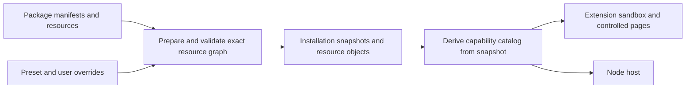

# 3.x capability model

[简体中文](capability-model.md) | [English](capability-model.en.md)

Capability packages contain installable implementations, feature declarations, and package defaults. Presets select packages and enabled targets, and override defaults. User overrides are stored separately. Source protocols, manifest validation, and pure computation modules define the contracts.



## Declarations and configuration

Package manifests use `schemaVersion: 1`, exact `id/version`, optional `requires.mearlApi`, `resources`, optional `defaults`, and optional `contributions`. Each resource declares its real SHA-256 digest and byte length. Referenced resources must be within the package. `appProfiles` is optional; parser-only and Agent packages do not need empty arrays.

`defaults` contains module configuration, for example `{ "gateway": "https://api.example.com", "timeout": 30 }`. Both sides use this merge chain:

```text
bundle.defaults
  → preset.defaults.capabilities[packageId]
  → userOverrides.capabilities[packageId]
```

Objects merge recursively; arrays, scalars, and null replace values. Only explicitly supplied user overrides are persisted, so unoverridden options follow package and Preset default updates. `configure({})` clears all user overrides, including capability configuration. There is no separate `nodeConfig` channel.

## Contributions

| Field | Contract |
| --- | --- |
| `appProfiles` | App JSON profile resource paths |
| `pageRuntimes` | Controlled-page installers exporting `install(config)` |
| `browserRuntimes.extension` | Extension background factory with entry and hook-to-handler bindings |
| `nodeRuntimes[host]` | Factories and hook bindings for the corresponding Node host |
| `extension` | Resource path of feature declaration JSON |
| `requestUi` | Declarations for existing request detail, link, login, and save locations |
| `browserViews` | View resources for request import, test cases, capture launchers, and controllers |
| `browserControls` | Network control option resources |

Example `extension` resource:

```json
{
  "schemaVersion": 1,
  "operations": {
    "identity.panel": { "hook": "identity.panel", "setting": "accountsEnabled" }
  },
  "logins": {
    "accounts": { "url": "https://accounts.example.com/login", "title": { "en": "Accounts" } }
  }
}
```

Each operation must bind a browser runtime in the same package. Multiple providers for the same operation or login are conflicts; load order cannot determine ownership. Preset `defaults.extension` configures settings only and cannot declare or redirect `operations/logins`.

## Execution locations

Contributions determine supported locations: browser runtimes, page runtimes, App profiles, and UI contributions support `browser`; Node runtimes support `node`. Packages containing only generic data can run on both.

Optional Preset `packages[id].targets` selects a subset of supported locations. Omission infers them from the package; explicitly requesting unsupported locations is rejected. The installation snapshot stores the resolution in `packageTargets` for offline recovery. Resource validation rechecks selected targets against contributions. Each target's dependencies must be satisfiable at that location.

Independent browser preparation reads manifests with unspecified targets to discover locations without downloading confirmed Node-only resources. Failures in Node-only resources do not affect an explicitly browser-only graph; complete installation still validates all selected resources.

## Capability catalog and invocation

`browserCapabilityRegistry` coordinates sources, installation, permissions, and status. `browserCapabilityCatalog` derives configuration, App catalogs, views, and runtime indexes from the same validated snapshot. Catalogs are reused by snapshot identity and parsed lazily; reading request details does not trigger unrelated view errors. No second independently mutable declaration catalog is persisted.

Each configuration-driven operation pins one snapshot, using it for service defaults and handler selection. User switches, domain authorization, and Chrome permissions are still checked at the relevant execution boundaries.

`NativeCapabilityHooks` defines core Node hook inputs, results, and factory types centrally. Callers obtain types by hook name; dynamic extension contracts use explicit `requireCustom`. Runtime structural validation is performed across browser messaging boundaries.

Browser and Node share generic resource selection through `CapabilitySelection/CapabilitySnapshot/CapabilityActivation`, with environment-specific executors. Node updates validate all target resources, reuse modules whose code and effective configuration are unchanged, then atomically switch bindings. Existing calls retain accepted handlers.

## Object storage and references

Browsers use the `mearl-capabilities-v3` IndexedDB:

| Store | Contents |
| --- | --- |
| `bundles` | Package identity, manifest, source, revision, and total resource size; no resource bytes |
| `objects` | `{ sha256, bytes }`, one digest-addressed copy per resource |
| `resourcePins` | Active document or controller references to exact code |
| `preset` | Active resource graph, installation association, and concurrency tokens |

Metadata and resources are read from one transactional snapshot, then sizes and digests are revalidated. Update and uninstall transactions reclaim objects according to final package and active references; code is deleted only after the last reference is released. Quotas count unique object bytes, without charging duplicates across packages, pages, and background modules.

Concurrent changes use revision comparisons; preparation failures retain the previous selection. Browser and Node activation are confirmed separately. External Skill and Provider installation may partially complete and requires explicit recovery; it is not a cross-process atomic transaction.

## Installation format and shared preferences

Browsers persist accepted resources using the current manifest and object-storage format. Preset configuration merges `bundle.defaults → preset.defaults.capabilities → userOverrides.capabilities`. The installer and Node host share `MEARL_CAPABILITY_DIR`.


Ordinary view preferences use package and slot namespaces. Shared editor settings use a limited `shared` contract: `editor.highlight` (session), `json.viewMode`, `json.shortcuts`, and `code.shortcuts` (local). Hosts validate slots, scopes, and declared names; views cannot select arbitrary host storage keys.

## Validation

Key regressions cover package/Preset/user configuration; clearing and restoring user overrides after deactivation; declaration ownership and conflicts; inferred targets, dependencies, and offline graphs; object deduplication, corruption isolation, concurrent conflicts, and last-reference reclamation; and Node handler identity across unrelated updates, rollback, and active sessions.

Follow the root [AGENTS.md](../AGENTS.md) for builds and checks. Pure browser and Node contracts are checked without Node globals. See [browser capabilities](browser-services.en.md), [installation coordination](preset-installation.en.md), and [Node capabilities](node-capabilities.en.md) for host details.
