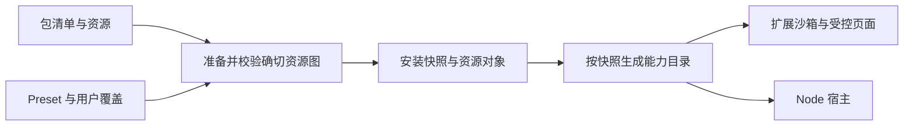

# 3.x 能力包模型

[简体中文](capability-model.md) | [English](capability-model.en.md)

能力包包含可安装实现、功能声明和包默认配置；Preset 选择这些包及其启用端，并提供默认配置覆盖；用户覆盖独立保存。源码中的协议、清单校验和纯计算模块是合同来源。



## 声明与配置

包清单使用 `schemaVersion: 1`、确切 `id/version`、可选 `requires.mearlApi`、`resources`、可选 `defaults` 和可选 `contributions`。每个资源声明真实 SHA-256 与字节数；清单引用的资源必须位于包内。`appProfiles` 可省略，纯解析器或 Agent 包不需要空数组。

`defaults` 是该包的模块配置对象，例如 `{ "gateway": "https://api.example.com", "timeout": 30 }`。两端采用同一条合并链：

```text
bundle.defaults
  → preset.defaults.capabilities[packageId]
  → userOverrides.capabilities[packageId]
```

对象递归合并，数组、标量和 null 替换。只持久化用户实际指定的覆盖；更新包默认值和 Preset 默认值时，未覆盖的选项随之更新。`configure({})` 清除全部用户覆盖，包括能力配置。没有单独的 `nodeConfig` 通道。

## 贡献

| 字段 | 合同 |
| --- | --- |
| `appProfiles` | 端模拟 JSON 配置资源路径列表 |
| `pageRuntimes` | 受控页面安装器；导出 `install(config)` |
| `browserRuntimes.extension` | 扩展后台工厂；声明入口与 hook 到处理器的绑定 |
| `nodeRuntimes[host]` | 对应 Node 宿主的工厂与 hook 绑定 |
| `extension` | 功能声明 JSON 的资源路径 |
| `requestUi` | 现有请求详情、链接、登录和保存位置的声明 |
| `browserViews` | 请求导入、用例、抓包启动器和控制器的视图资源 |
| `browserControls` | 网络控制选项资源 |

`extension` 资源示例：

```json
{
  "schemaVersion": 1,
  "operations": {
    "identity.panel": { "hook": "identity.panel", "setting": "accountsEnabled" }
  },
  "logins": {
    "accounts": { "url": "https://accounts.example.com/login", "title": { "en": "Accounts" } }
  }
}
```

每个 operation 必须绑定同包的浏览器运行时；同名 operation 或 login 的多个提供者导致冲突，不能由加载顺序决定归属。Preset 的 `defaults.extension` 仅用于配置，不能声明或重定向 `operations/logins`。

## 运行位置

包的贡献决定它支持的位置：浏览器运行时、页面运行时、端模拟配置和界面贡献支持 `browser`，Node 运行时支持 `node`；仅包含通用数据的包可用于两端。

Preset 的 `packages[id].targets` 可选，用于启用支持位置的子集。省略时从包推导；显式请求不支持的位置会被拒绝。安装快照的 `packageTargets` 保存本次解析结果，离线恢复无需重新读取来源。资源校验再次核对所选端与实际贡献。每个位置的包依赖必须能在该位置满足。

浏览器独立准备会读取未指定 targets 的包清单以发现位置，不下载已确认仅用于 Node 的资源。Node-only 包的资源失败不会影响一个明确只选择 browser 的包图；整套安装仍校验全部所选资源。

## 能力目录与调用

`browserCapabilityRegistry` 负责来源、安装、授权协调及状态；`browserCapabilityCatalog` 从同一份已校验快照派生配置、App 目录、视图和运行时索引。目录按快照对象复用，各部分按需解析，单独的视图错误不会由请求详情读取代为触发。目录不持久化第二份可独立修改的声明。

一次配置驱动的操作固定同一份快照，服务默认值与处理器选择均从该快照读取；用户开关、域名授权与 Chrome 权限仍在相应执行边界检查。

`NativeCapabilityHooks` 集中定义核心 Node hook 的输入、结果和工厂类型。调用方通过 hook 名取得类型；扩展的动态合同通过显式 `requireCustom` 接入。跨浏览器消息边界执行运行时结构校验。

通用资源选择使用 `CapabilitySelection/CapabilitySnapshot/CapabilityActivation`，由 Browser 与 Node 共用；实际执行器按各自运行环境实现。Node 更新先验证全部目标资源，再复用代码和有效配置均未变化的模块，最后原子切换绑定表。旧调用保留已接受处理器。

## 对象存储与引用

浏览器使用新的 `mearl-capabilities-v3` IndexedDB：

| Store | 内容 |
| --- | --- |
| `bundles` | 包身份、清单、来源、revision 与总资源大小；不保存资源字节 |
| `objects` | `{ sha256, bytes }`，全部资源按摘要唯一保存 |
| `resourcePins` | 活动文档或控制器对确切代码的引用 |
| `preset` | 活动资源图、安装关联及并发令牌 |

读取元数据与资源在同一事务快照中进行，取出后再次校验大小和摘要。更新和卸载的事务按最终包引用与活动引用回收对象；只有最后一个引用释放后才删除代码。配额按唯一对象字节计算，包、页面与后台模块不重复计费。

并发修改仍使用 revision 比较；准备失败保留原选择。两端激活分别确认，Skills 和 Provider 的外部安装可部分完成并显式恢复，不能伪装成一个跨进程原子事务。

## 安装格式与共享偏好

浏览器使用当前清单与对象存储格式保存已接受资源；Preset 配置按 `bundle.defaults → preset.defaults.capabilities → userOverrides.capabilities` 合并。安装器与 Node 宿主使用相同的 `MEARL_CAPABILITY_DIR`。


视图普通偏好使用包和 slot 命名空间；共享编辑器设置使用有限的 `shared` 合同：`editor.highlight`（session）、`json.viewMode`、`json.shortcuts`、`code.shortcuts`（local）。宿主校验 slot、作用域和已声明名称，视图不能选择任意宿主存储键。

## 验证

重点回归包括：包/Preset/用户三级配置、用户覆盖清除与停用后恢复；功能声明的归属与冲突；自动位置推导、依赖和离线图；对象去重、损坏隔离、并发冲突及最后引用回收；Node 无关更新的处理器身份、失败回滚和活动会话。

构建和检查按根目录 [AGENTS.md](../AGENTS.md) 执行；浏览器与 Node 的纯合同继续通过无 Node 全局的检查。更多宿主细节见 [浏览器能力](browser-services.md)、[安装协调](preset-installation.md) 和 [Node 能力](node-capabilities.md)。
